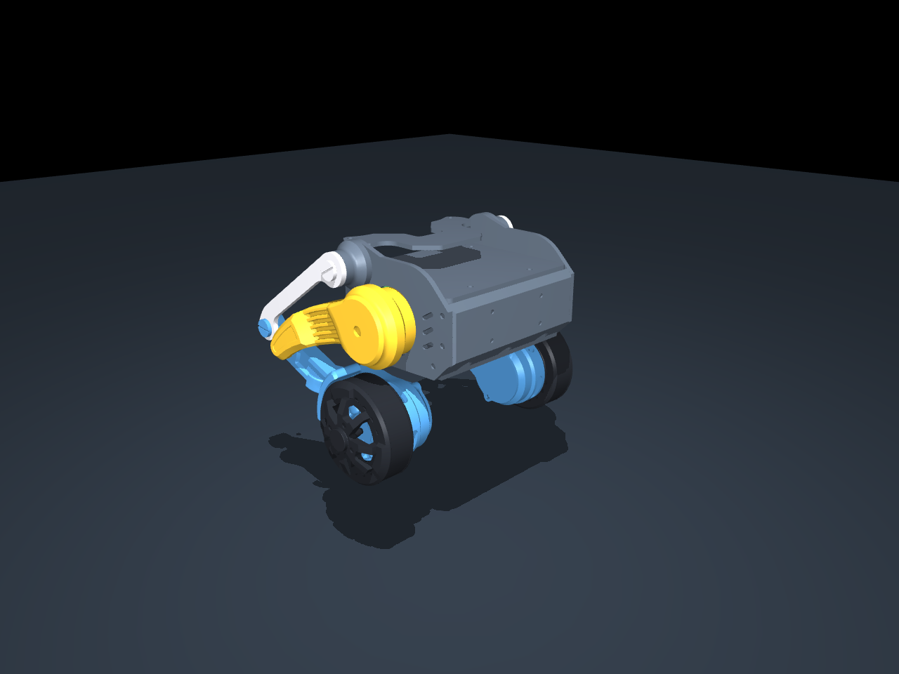

# Micro-Wheeled-leg Robot · MuJoCo 模型

基于 [MuShibo/Micro-Wheeled_leg-Robot](https://github.com/MuShibo/Micro-Wheeled_leg-Robot) 原始机械设计整理的 MuJoCo 仿真模型。

**维护者：dycsrl。** 本项目负责 STEP → MJCF 转换、模型整理和离线验证，不是原机器人的机械设计项目，也不代表原作者官方发布。



## 包含什么

- 原始 STEP 转换的真实零件网格，以及四杆闭环 MJCF。
- 双轮电压近似执行器、双腿位置执行器、自由基座。
- 地面碰撞代理和轮胎—外腿壳的选择性碰撞。
- 查看、运动/跌落检查、逐毫秒地面余量检查、抽样 STEP 实体求交脚本。

不包含训练权重、PPO 环境、固件、串口控制、实机日志或私人配置。

## 快速开始

Python 3.12；本次在 Windows 上使用 MuJoCo 3.2.5 验证。

```powershell
py -3.12 -m venv .venv
.venv\Scripts\python.exe -m pip install -r requirements.txt
.venv\Scripts\python.exe scripts/eval_sim.py
.venv\Scripts\python.exe scripts/check_ground.py --label local
.venv\Scripts\python.exe -m unittest discover -s tests -v
```

交互查看：`.venv\Scripts\python.exe scripts/eval_sim.py --view`。
模型没有平衡控制器，自由基座在重力下倒下是预期行为。静态预览及运动 GIF 中的固定机身是显式测试条件，不代表自主站立。

CAD 重建和实体求交需额外依赖与原始 STEP，见 [SETUP.md](SETUP.md)。运行结果写入 `outputs/`，不覆盖归档证据。

## 状态与限制

本项目定位为**几何建模与仿真探索模型**，不宣称动力学已标定或可直接迁移实机。当前验证记录见 [docs/VALIDATION.md](docs/VALIDATION.md)。

- 整机质量 336 g、电池 58 g 来自本项目实物测量，不代表上游所有复刻机器。
- 电池位置、质量分布、摩擦、轮电机参数、舵机 PD 与关节范围包含估计。
- 仅检查声明的运动/跌落轨迹及指定零件对；不是完整运动范围、全部零件自干涉或制造间隙认证。
- 基线不包含为控制器试验添加的滚动阻力校准，也不交付站立或跳跃策略。

详见 [建模假设](docs/model-assumptions.md)。

## 目录

```text
assets/    正式 MJCF、模型参数、必需网格
scripts/   重建、查看、仿真和几何检查
tests/     离线资产与模型测试
docs/      来源、假设、预览及本次验证摘要
outputs/   本机运行产生的报告与动画（Git 忽略）
```

## 作者与致谢

- **dycsrl**：本 MuJoCo 模型项目的整理、仿真建模与维护。
- **穆世博（Mu Shibo / MuShibo）、李育锋（Li Yufeng）**：原工程列出的开源贡献者。感谢两位公开机械结构、硬件与软件资料，为本项目提供基础。
- 感谢 [MuJoCo](https://github.com/google-deepmind/mujoco)、[CadQuery](https://github.com/CadQuery/cadquery)、[CoACD](https://github.com/SarahWeiii/CoACD) 与 [trimesh](https://github.com/mikedh/trimesh)。

## 来源声明

本项目基于 [MuShibo/Micro-Wheeled_leg-Robot](https://github.com/MuShibo/Micro-Wheeled_leg-Robot) 整理，原始设计及相关资料的权利归原作者所有，相关权利及使用条件以原项目声明为准，本项目不另行变更其授权条件。感谢原作者的分享与贡献。

如本项目内容涉及侵权，请联系维护者 dycsrl，我们将及时核实并修改或删除相关内容。
